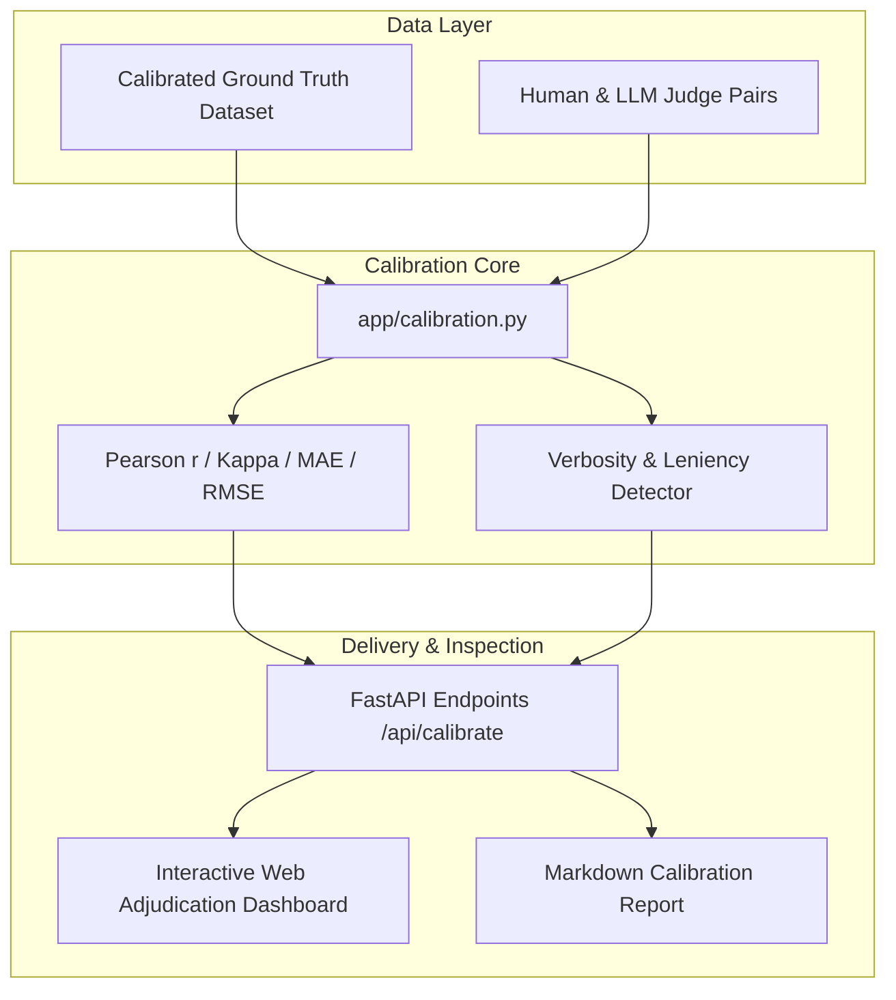

# JudgeBench: AI-as-a-Judge Reliability & Inter-Rater Calibration Benchmark

[](https://github.com/SriRamKunamsetty/judgebench/actions)
[](https://fastapi.tiangolo.com)
[](https://docs.pydantic.dev)
[](https://www.docker.com/)

> **JudgeBench** is an evaluation engineering benchmark and diagnostic platform designed to quantify, calibrate, and detect systemic bias in **AI-as-a-Judge** scoring pipelines against calibrated human specialist baselines.

---

## 🎯 Alignerr Competency Mapping

| Alignerr Role Competency | How JudgeBench Proves Mastery |
| :--- | :--- |
| **Objective Quality Assessment** | Implements standard inter-rater agreement statistics (Pearson $r$, Quadratic Weighted Kappa $\kappa_w$, MAE, RMSE) comparing LLM automated judges against human ground truth. |
| **Spotting Subtle Nuances & Bias** | Uncovers and measures **verbosity bias** (correlation between response character length and AI judge score inflation) and systematic leniency/severity shifts. |
| **Structured Rationale Feedback** | Visual adjudication inspector with side-by-side human vs AI rationale breakdown, isolating the precise root causes of score divergence ($\ge 1.0$). |
| **Production Engineering** | Standalone FastAPI backend, responsive client dashboard, pre-packaged Docker container, and GitHub Actions CI suite. |

---

## 📐 Mathematical Foundations

JudgeBench implements rigorous psychometric and statistical measures for inter-rater agreement:

### 1. Pearson Correlation Coefficient ($r$)
Measures the linear alignment between human ratings $H$ and automated judge ratings $A$:
$$r = \frac{\sum (H_i - \bar{H})(A_i - \bar{A})}{\sqrt{\sum (H_i - \bar{H})^2 \sum (A_i - \bar{A})^2}}$$

### 2. Quadratic Weighted Kappa ($\kappa_w$)
Measures chance-adjusted agreement for ordinal rubric ratings, penalizing large discrepancies quadratically:
$$w_{ij} = 1 - \frac{(i - j)^2}{(k - 1)^2}$$
$$\kappa_w = 1 - \frac{\sum w_{ij} O_{ij}}{\sum w_{ij} E_{ij}}$$

### 3. Verbosity Bias Index
Calculates Pearson correlation between response token length and the signed error delta $(A_i - H_i)$. A positive coefficient indicates that the AI judge systematically awards higher scores to longer, fluffier responses regardless of factual merit.

---

## 🏛️ System Architecture



---

## 🚀 Quick Start

### Option 1: Run with Local Python

```bash
# Clone repository
git clone https://github.com/SriRamKunamsetty/judgebench.git
cd judgebench

# Install dependencies
pip install fastapi uvicorn pydantic pytest httpx ruff

# Start the calibration server
uvicorn app.main:app --reload --port 8000
```
Open [http://localhost:8000](http://localhost:8000) in your browser.

### Option 2: Run with Docker

```bash
docker build -t judgebench .
docker run -p 8000:8000 judgebench
```

---

## 🧪 Running Automated Tests & Linting

```bash
# Run complete test suite
pytest -v tests/

# Run static analysis
ruff check .
```

---

## 📡 API Reference

- `GET /health` — Service health check.
- `GET /api/benchmark-dataset` — Loads calibrated benchmark evaluation pairs.
- `POST /api/calibrate` — Computes full calibration report (agreement stats, bias metrics, severe disagreement list).
- `POST /api/reports/markdown` — Generates a publication-ready Markdown calibration audit.

---

## 👤 Author
**Sri Ram Kunamsetty** — AI Evaluation & Robustness Specialist  
[GitHub Profile](https://github.com/SriRamKunamsetty)
